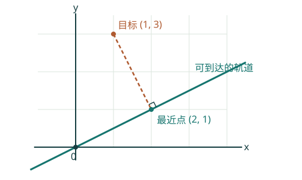

# 投影为什么给出到直线的最近点

给定向量 $v=(1,3)$，在 $u=(2,1)$ 张成的直线上寻找距离 $v$ 最近的点。任意候选点都形如 $tu$。沿水平方向对齐会给 $t=1/2$，沿竖直方向对齐又会给 $t=3$。两种做法都偏爱一个坐标，要一起考虑两方向的偏差，可以直接比较距离平方：
$$\|v-tu\|^2=(1-2t)^2+(3-t)^2=5(t-1)^2+5.$$
最小处 $t=1$，最近点为 $(2,1)$。从最近点指向目标的余差 $(-1,2)$ 恰好与原直线垂直。

把刚才的展开照搬到任意向量，混合项中反复出现“各分量成对相乘再求和”。在实数坐标中将它记为 $a\cdot b=\sum_i a_i b_i$，即通常的**内积**。那么 $\|v-tu\|^2=\|v\|^2-2t(v\cdot u)+t^2\|u\|^2$。配平方知道，当 $u\ne0$ 时最优的系数必为 $t=(v\cdot u)/(u\cdot u)$，它恰使 $(v-tu)\cdot u=0$。由余弦定理，内积也等于 $\|u\|\|v\|\cos\theta$；内积为零称正交。

**最近点留下的余差，不能再沿着允许的方向缩短。** 在有限维实内积空间里，向子空间作正交投影就是找一个子空间中的点，使余差同子空间每个向量都正交。对任意别的候选点，添上的子空间位移与余差正交，距离平方多出该位移的长度平方。更一般地，实内积只要求对称、对每个变量线性，且 $\langle v,v\rangle$ 对非零 $v$ 总为正。不同的内积相当于选了不同的距离尺，最近点也可能随之改变。
