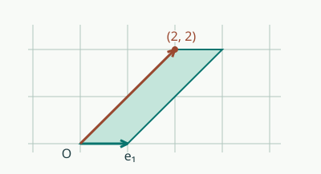

# 为什么矩阵的复合会给出“行乘列”

设平面上的一个变换把竖直方向拉长为两倍，另一个把每个点向右错开一段距离，错开的距离等于它的纵坐标。用 $B(x,y)=(x,2y)$ 记录拉伸，用 $A(x,y)=(x+y,y)$ 记录错切。如果每次都先做 $B$ 再做 $A$，能否一次写出整个过程？

把第一步的输出交给第二步，直接代入可得
$$
A(B(x,y))=A(x,2y)=(x+2y,2y).
$$
对这两个给定变换，代入已经解决了计算问题。现在想更进一步：能否只记录少数几个向量的去向，再用同一种办法算出两步合成的结果？

### 先追踪两个基向量

用 $e_1=(1,0)$ 记水平单位向量，用 $e_2=(0,1)$ 记竖直单位向量。为什么会想从它们入手？任何位移 $(x,y)$ 都能沿这两个方向分解，问题是这种分解在变换后能否保留。如果只知道一个变换对这两点的作用，其他点一般仍不能确定。例如 $S(x,y)=(x,y+xy)$ 与恒等映射都固定 $e_1,e_2$，但它们把 $(1,1)$ 分别送到 $(1,2)$ 和 $(1,1)$。因此，能从两个数据推知全平面，必然还用到了变换的其他性质。

本例的拉伸与错切都保持加法和数乘。这样的映射叫作线性映射，满足 $T(u+v)=T(u)+T(v)$ 和 $T(cu)=cT(u)$。任意 $(x,y)$ 都有唯一分解 $xe_1+ye_2$，所以 $T(x,y)=xT(e_1)+yT(e_2)$。一旦知道这两个像，对每个输入就有了确定答案。**两次这样的变换接连进行，原来的相加与数乘关系在第一步和第二步都得以保持，所以复合后仍然线性。** 为了便于计算，将 $T(e_1)$ 的两个分量列成第一列，将 $T(e_2)$ 的两个分量列成第二列。于是，矩阵的第一列记录 $e_1=(1,0)$ 的像，第二列记录 $e_2=(0,1)$ 的像。拉伸和错切的矩阵分别为
$$B=\begin{pmatrix}1&0\\0&2\end{pmatrix},\qquad A=\begin{pmatrix}1&1\\0&1\end{pmatrix}.$$
$e_1$ 经两步仍为 $(1,0)$。$e_2$ 先到 $(0,2)$，再到 $(2,2)$。按原来的列顺序写下这两个结果，得到
$$AB=\begin{pmatrix}1&2\\0&2\end{pmatrix}.$$
这里将后做的变换写在左边，是为了让 $(AB)v=A(Bv)$ 与函数复合的写法一致。现在再计算一次 $(AB)(x,y)$，正好得到直接代入的 $(x+2y,2y)$。

同形的数表也可以把对应位置逐项相乘。但在这里，这样会得到 $\left(\begin{smallmatrix}1&0\\0&2\end{smallmatrix}\right)$，把 $e_2$ 送到 $(0,2)$。错切时新增的水平分量丢失了。**复合要求把前一步的每一个输出方向交给下一步处理，同一位置上的两个数并不能单独决定结果。**

### 为什么任意一列都可以照这样计算

设
$$A=\begin{pmatrix}a&b\\c&d\end{pmatrix},\qquad B=\begin{pmatrix}p&q\\r&s\end{pmatrix}.$$
$B$ 的第一列说的是 $Be_1=pe_1+re_2$。要继续做 $A$，由线性可得 $A(Be_1)=pAe_1+rAe_2$。因此乘积第一列是 $A$ 的两列以 $p,r$ 为系数的组合，即 $(ap+br,cp+dr)$。对第二列重复推理，得
$$AB=\begin{pmatrix}ap+br&aq+bs\\cp+dr&cq+ds\end{pmatrix}.$$
从列看，我们逐个求 $A(Be_j)$。从单个位置看，要得到第 $i$ 个输出分量，就取 $A$ 的第 $i$ 行，与 $B$ 的第 $j$ 列对应相乘后求和。**行乘列来自一个具体的问题：初始的第 $j$ 个基方向，经过所有中间方向后，对最终的第 $i$ 个方向贡献了多少？**

若 $B$ 把 $n$ 维输入送到 $k$ 维，$A$ 把 $k$ 维输入送到 $m$ 维，这个问题依然成立。中间方向共有 $k$ 个，于是 $(AB)_{ij}=\sum_{\ell=1}^k A_{i\ell}B_{\ell j}$。结果有 $m$ 行、$n$ 列。若 $B$ 的输出维数与 $A$ 的输入维数不同，就无法将前一步的输出原样作为后一步的输入。

### 交换次序会怎样

仍追踪同一个 $e_2$。先错切再拉伸，它依次到 $(1,1)$ 和 $(1,2)$；先拉伸再错切，终点是 $(2,2)$。两个线性变换在一个输入上已经不同，故 $BA\ne AB$。检查一个输入足以否定相等；若要由有限次检查证明相等，检查一组基就够了，因为每个输入都是这组基的线性组合。
