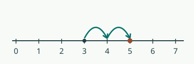

# 怎样由后继定义两个自然数的和？

两组记录互不重复，第一组已经数得三项，第二组数得两项。把它们合起来，从头清点当然能得到结果，但第一组原有的计数又做了一遍。保留“三”这个结果，把第二组第一项计入时只需走到四，最后一项计入时走到五。这次实际进行了两次“取[后继](natural.md)”，一步对应第二组的一项。

将例子里的三、二换成任意自然数 $a,b$，同样可以从 $a$ 开始，每计入第二组的一项取一次后继。因此要定义 $a+b$，只需让第二个输入负责记录已推进多少步。没有第二组对象时停在 $a$；若比 $b$ 再多一个，就在 $a+b$ 的结果上再取一次后继：

$$
a+0=a,\qquad a+S(b)=S(a+b).
$$

从 $3$ 出发，分别取零次、一次、两次、三次、四次后继，依次得到 $3,4,5,6,7$。例如 $3+2=S(3+1)=S(S(3+0))=5$。每计算一步，待处理的第二个输入就减去一个后继，最终回到已指定的初值。

## 为什么可以改变括号和次序？

先合 $a,b$ 再加 $c$，和先合 $b,c$ 再把结果加到 $a$ 上，计数上应有相同结果。要从定义证明 $(a+b)+c=a+(b+c)$，固定 $a,b$，让 $c$ 改变。在 $c=0$ 处两边都是 $a+b$。把 $c$ 换成 $S(c)$，左边是 $S((a+b)+c)$，右边是 $a+S(b+c)=S(a+(b+c))$。只要前一步两边相等，新的一步就仍相等，由归纳得到结合律。

交换律看似更直观，证明却多出一步：定义只直接说明第二项增加时和怎样改变，它对第一项增加时的情况没有作出规定。先问两个较小的问题。第一，$0+a=a$ 吗？从 $0+0=0$ 开始，$a$ 增加一次，两边按定义各取一次后继，因此恒等。第二，$S(b)+a=S(b+a)$ 吗？对固定的 $b$，在 $a=0$ 时两边同为 $S(b)$；$a$ 每增加一次，两边又各取一次后继，也恒等。**现在已经证明，无论哪一项取后继，原来的和都只取一次后继。**

这两个较小的问题为什么正好能接上原来的证明？先假设两组大小为 $a,b$ 时顺序无关，再问第二组多出一项时怎么办。原顺序的结果是 $a+S(b)$，可按定义把后继移到整个和外面；交换后是 $S(b)+a$，后继却出现在第一项。第二个等式恰好允许我们把这一步也移到外面。现在固定 $a$ 对 $b$ 做归纳，起点 $a+0=a=0+a$ 由第一个等式保证。若 $a+b=b+a$，则

$$
a+S(b)=S(a+b)=S(b+a)=S(b)+a .
$$

因此 $a+b=b+a$，称为交换律。计数的直觉提供了猜想，证明中额外出现的那个等式说明了为什么原本不对称的写法仍能得到对称的结果。

还可以反过来问，从 $a$ 起需补多少才到 $b$？若存在自然数 $c$ 使 $a+c=b$，就记 $a\le b$；若同时 $a\ne b$ 就记 $a<b$。这个 $c$ 唯一：从 $a$ 出发的两个不同步数不可能抵达同一点，因为 $a$ 自身已在从 $0$ 出发的不重复的后继序列中。这个唯一的数叫差 $b-a$。例如从 $2$ 起，依次再走一步、两步、三步，第三次达到 $5$，所以 $5-2=3$。交换次序，要从 $5$ 出发只取后继而回到 $2$，这在自然数内做不到；它是稍后扩充数系的理由。

最后回到两份记录：如果甲、乙在第一组，乙、丙在第二组，加法当然仍给出 $2+2=4$，但四是两份名单的记录条数。若要数不同的人，重复出现的乙只能算一次，实际有三人。
