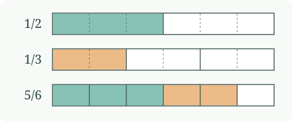

# 分数相加时，究竟哪些数可以直接相加？

从 $\tfrac12+\tfrac13$ 开始。若把分子、分母分别相加，得到 $2/5$。即使没有正确的算法，也能否决这个结果：在 $\tfrac12$ 上加一个正量，和应比 $\tfrac12$ 大；$2/5$ 换成十分之四，反而比十分之五小。

为什么分别相加会显得合理？如果两批观察中第一批两次出现一次成功，第二批三次也出现一次成功，合并记录后，确实是总共五次、成功两次，比例为 $2/5$。但原问题是把同一单位长度的两段相接。把两个分母相加，相当于把作为比较基准的两个整体也合并了，回答的是另一个问题。

回到线段，第一个分子里的 $1$ 表示一个二分之一，第二个分子里的 $1$ 表示一个三分之一。若要像整数那样加份数，需要先找一个能把两者都写成整数份的单位。把每个二分之一再三等分，把每个三分之一再二等分，两边就都以六分之一计量了。

沿图的上面两行各自数一遍，原先那一个“半份”现在对应三格，原先的一个“三分之一份”对应两格。把这两段首尾相接，底下一行从第三格继续数到第五格。于是 $\tfrac12+\tfrac13=\tfrac36+\tfrac26=\tfrac56$。

图中三条线段采用同一个整体单位；若“半份”和“三分之一份”取自大小不同的整体，又会怎样？一米的二分之一加上两米的三分之一，第一段是 $1/2$ 米，第二段是 $2/3$ 米，和为 $7/6$ 米。直接写 $5/6$ 就把第二个整体误当成了一米。只有先约定共同整体，随后选的“六分之一”才对应同一种长度。**通分改变表示一个数所用的单位，同时保留这个数的值。** 已经同分母时，分母明确约定了单位，算和只需加分子。

对一般的 $a/b$ 和 $c/d$，取正分母 $b,d$。$bd$ 总可用作共同分母，因为每个 $1/b$ 能细分为 $d$ 份，每个 $1/d$ 能细分为 $b$ 份。用[分数相等的条件](rational.md)重新表示两项，就得到

$$
\frac ab+\frac cd=\frac{ad}{bd}+\frac{bc}{bd}=\frac{ad+bc}{bd}.
$$

共同分母不必取 $bd$。例如 $\tfrac16+\tfrac14$ 用十二等份就够，和为 $\tfrac2{12}+\tfrac3{12}=\tfrac5{12}$；若用了二十四等份，结果是 $\tfrac{10}{24}$。每一小份再对半，分子、分母同时加倍，实际数值不变。更一般地，若用了两种不同的共同分母，把两种结果再细分到这两个分母的积，每项就都换到了同一个单位，两种加法必给出同样结果。

减法沿用这一论证，在同一单位下把对应的份数相减即可。因此差为 $(ad-bc)/(bd)$。以 $\tfrac16-\tfrac14$ 为例，换成十二等份后从两份减去三份，结果是 $-1/12$。分子可以为负并不改变单位的大小。
