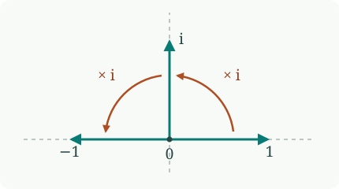

# 怎样构造一个平方等于负一的数？

希望解方程 $x^2=-1$。在实数中，无论正数、负数还是零，平方都非负，故要满足这个要求必须扩充数系。几何给出一个构造线索：乘以 $-1$ 会把实轴上的点移到关于原点对称的位置，如果将这个变化看成半周旋转，那么旋转四分之一周，执行两次恰好是半周。四分之一周会让点离开实轴，因此用平面来表示候选的新数。

取有序实数对 $(a,b)$ 记录水平、竖直分量，两个数对相等要求对应分量分别相等。原来的实数 $a$ 记作 $(a,0)$，另记 $i=(0,1)$。把位移相接时两个分量分别相加，所以规定 $(a,b)+(c,d)=(a+c,b+d)$。以 $bi$ 表示竖直分量 $(0,b)$，这样 $(a,b)$ 就写成 $a+bi$。$a$ 是实部，$b$ 是虚部。希望新乘法既能给出 $i^2=-1$，又能延续原先的分配律及实数系数的交换性。

一个直接的尝试是各坐标分别相乘，可它使 $(0,1)(0,1)=(0,1)$，没有产生要求的 $(-1,0)$。改从要保留的运算律推回去。若分配律有效，把两个括号逐项展开时就必须有

$$
(a+bi)(c+di)=ac+adi+bci+bd\,i^2=(ac-bd)+(ad+bc)i .
$$

于是用右边定义两个数对的乘积，再检验目标是否实现。代入 $i$ 两次得到 $-1$；一般的 $(a,b)$ 乘以 $i$ 得到 $(-b,a)$，恰是[平面坐标](../geometry/coords.md)中的逆时针直角旋转。取 $2+i$，旋转两次就沿着 $2+i,\ -1+2i,\ -2-i$ 到达相反数。若两个因子竖直分量都为零，相乘与相加都还原原来的实数运算。**按这些加法和乘法规则运算的有序实数对叫作复数。**

## 如何给非零复数找倒数？

先找一个数，让 $2+i$ 乘上它恰好为 $1$。乘积要落在实轴上，虚部里的两项必须抵消。若保持第二个因子的实部 $2$，把虚部的符号反过来，两个交叉项就变成 $-2i$ 和 $2i$。于是 $(2+i)(2-i)=5$。再将第二个因子的两个分量都除以 $5$，得到所需的倒数 $(2-i)/5$。

这个消去虚部的方法并不依赖所取的数字。将 $a+bi$ 的虚部变号得到 $a-bi$，称为共轭。两者之积是 $a^2+b^2$。只要 $a,b$ 不同时为零，这个实数就为正，因此 $(a-bi)/(a^2+b^2)$ 是 $a+bi$ 的倒数。这样，除以非零复数也有了定义。

最后试着把实数的大小关系延伸到全体复数，并保留原有的加法次序和正数相乘为正的性质。任一非零数若为正，平方为正；若为负，相反数为正，而两者平方相同，平方仍应为正。用在 $i$ 上却得到 $i^2=-1<0$。这说明在获得新方程解的同时，不能把实数的有序四则运算结构原封不动地扩展到整个平面。
