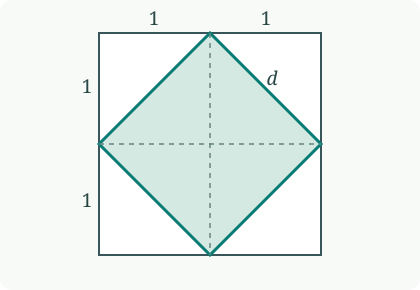

# 单位正方形的对角线能用分数表示吗？

把边长为 $2$ 的正方形分成四个单位方格，依次连接外框四条边的中点，中间四边分别是四个单位方格的对角线，因此等长；相邻两边各与水平线成 $45$ 度，一升一降，夹角为直角。这样便知道中央的图形确实是以单位方格对角线为边的正方形。

先不量斜边，而去算它所围住的面积：外框面积为 $4$，四角各是一个单位方格的一半。扣掉这四个直角三角形，留下 $4-4\cdot\tfrac12=2$。用面积比较的好处在于，只需数熟悉的方格，却能给未知的斜边一个精确条件。若以 $d$ 记单位方格的对角线长，问题就化为求 $d>0$ 使 $d^2=2$。

如果把这条对角线估成 $1.4$，平方为 $1.96$；改取 $1.41$ 又更接近。很自然会怀疑，只是还没找到分母合适的那个分数。增加试算精度能留下候选，却不可能逐一排除所有分母。换个方向：假定这样的分数果真存在，看它的分子、分母被迫满足什么条件。

若 $d=p/q$，其中 $p,q$ 为正整数，遇到分子、分母都是偶数，可以同时除以 $2$；分母严格减小，重复这个操作一定会停，所得表示的分子、分母至少有一个为奇数。现在 $p^2=2q^2$，故 $p^2$ 是偶数。奇数 $(2k+1)$ 的平方为 $2(2k^2+2k)+1$，所以 $p$ 也必须是偶数。令 $p=2m$ 代回去，得到 $q^2=2m^2$，同理 $q$ 也是偶数。这个结果与刚才选好的表示矛盾。增加分母也无济于事，因为论证适用于每一种正分数。

## 没有有理数解，怎样证明有实数解？

刚才只排除了一类候选数。要证明实数中真的有解，也不能仅凭图形上能画出这条线段，就默认每种几何长度已在数系中找到对象。可以先收集一侧所有已知试值：边长试小了，平方小于目标；试大了，平方超过目标。非负的边长越大，其平方越大，因为 $0\le u<v$ 时有 $v^2-u^2=(v-u)(v+u)>0$。因此，一旦某个试值已经过大，它右侧的值全部过大。这个判断让我们有理由把符合条件的试值的右边界当作候选解。

给定正实数 $a$，令 $E$ 为所有满足 $x\ge0$、$x^2\le a$ 的实数 $x$。它包含 $0$；$a+1$ 是上界，因为 $(a+1)^2>a$，且非负数越大平方越大。由[实数的完备性](real.md)，$E$ 有最小上界 $s$。为什么恰好是 $s^2=a$？

先假设 $s^2<a$。如果只说“略微增加 $s$，面积还来不及超过 $a$”，其实是在预先使用一个尚未证明的连续性判断。需要给出一步究竟有多小才够。增加边长 $h$，面积增量是 $(2s+h)h$。先要求 $h<1$，第一因子就小于固定的 $2s+1$；接下来只须让这个固定数乘 $h$ 小于剩余面积 $a-s^2$。

即使暂时只会用有理数选步长，也能做到。由上一节的分割构造，选正有理数 $c<a-s^2$，再选正有理数 $M>2s+1$（分割外总有有理刻度，再向右取一个即可）。取正有理数 $h<\min(1,c/M)$。面积增加量小于 $Mh<c<a-s^2$，故 $s+h$ 仍在 $E$ 中，却已超过上界 $s$。

若 $s^2>a$，则 $s>0$，这次应把上界稍微减小，看它会不会仍然偏大。缩短 $h$ 后的面积为 $s^2-2sh+h^2$，减少的面积至多 $2sh$。选正有理数 $c<s^2-a$ 和 $M>2s$，再取正有理数 $h<s$ 且 $h<c/M$。于是 $s-h>0$，并且 $(s-h)^2\ge s^2-2sh>a$。既然这个较短的边长仍然过大，每个合格边长都比它小。这样 $s-h$ 也是上界，却小于最小上界 $s$，又产生矛盾。

两种情况下都能把边界向不该移动的方向移动，唯一留下的可能便是 $s^2=a$。

同一个边界于是承担了两项不同工作。完备性让我们找到最小上界，两次具体估计说明这个数的平方恰好是目标。至于唯一性，前面已算出非负数严格增大时平方也严格增大，故方程不可能有两个不同的非负解。**满足 $x^2=a$ 的实数都叫平方根，符号 $\sqrt a$ 专指其中唯一的非负数，称为算术平方根。** $a=0$ 时这个数就是 $0$。结合前面的两个证明，$\sqrt2$ 存在且不能写成整数之比；这类实数称为无理数。

例如方程 $x^2=9$ 的实数解有 $3,-3$ 两个，$\sqrt9$ 只取 $3$。因此 $\sqrt{x^2}=|x|$，这里 $|x|$ 是 $x$ 到零的距离。若改为 $x^2=-1$，实数的平方非负，前述构造也只对非负目标适用。还想保留这样的方程，就会导向[复数](complex.md)。
