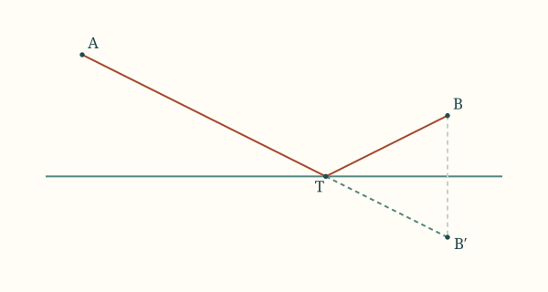

# 指定经过一条直线，怎样找到最短的两段折线？

取直线 $y=0$ 同一侧的两点 $A=(0,2),B=(6,1)$。在这条直线上求一点 $T$，使 $AT+TB$ 最小。直接用三角不等式只能得到 $AT+TB\ge AB$，因为 $AB$ 与给定直线没有交点，这个下界不能达到。需要一种保留每个候选长度、又能把两段合为一条直线的做法。

把 $B$ 关于给定直线反射到 $B^\prime=(6,-1)$。直线上每个 $T$ 都满足 $TB=TB^\prime$，故 $AT+TB=AT+TB^\prime\ge AB^\prime=\sqrt{45}$。线段 $AB^\prime$ 确实与直线相交，交点为 $(4,0)$，所以这个下界能达到。**反射保证每个候选的总长度保持，三点共线给出取得最小值的位置。** 若限制 $T$ 只能在直线的一段上取值，还须检验所求交点确实在允许的线段内。

换一种约束，两段的接头还要相差一个固定向量，例如中间必须沿固定方向跨一座长为 $d$ 的桥。把终点平移一个反桥向量，就能删掉那段恒长的桥，再对余下的两段用三角不等式。若接头间给的是固定转角和相等边长，试旋转更自然：绕 $O$ 把 $P$ 转 $60^\circ$ 到 $P'$，则 $PP'=OP$，整段原本连向 $O$ 的距离便能被搬到 $PP'$。这正是[费马点](fermat.md)的构造所用的等长关系。
