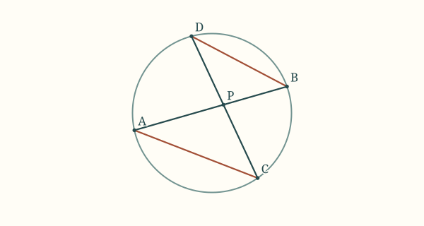

# 转动经过定点的弦，哪个量保持不变？

固定圆内一点 $P$，让一条过 $P$ 的直线与圆交于 $A,B$。方向变化时，$PA,PB$ 及其和都可能改变。再取一条过 $P$ 的弦 $CD$，两条弦的四个端点都在同一圆上。由[圆周角定理](inscribed-angle.md)，截同一弧的角相等，这是构造相似三角形的线索。相似给出长度比，两比相等将产生一个乘积恒等式。

连 $AC,DB$。$\angle APC=\angle DPB$ 是对顶角；$\angle PAC=\angle BAC$ 与 $\angle PDB=\angle CDB$ 都看着弦 $BC$，$A,D$ 在弦的同一侧，所以相等。于是 $\triangle PAC\sim\triangle PDB$，从 $PA/PD=PC/PB$ 得
$$
PA\cdot PB=PC\cdot PD .
$$
例如一条弦的两段是 $2,8$，另一条的短段若是 $1.6$，长段就只能是 $10$。原来缩短一边并非毫无约束，积是固定的。

如果 $P$ 在圆外，这个积还会保持吗？换一种同时照顾内外的方法。设圆心为 $O$，半径为 $r$。从 $O$ 向任一条过 $P$ 并与圆相交的直线作垂线，垂足为 $H$。圆关于 $OH$ 翻折对称，因此 $H$ 恰是截出弦的中点（过圆心时取 $H=O$）。记半弦长为 $s$，则 $s^2=r^2-OH^2$，同时 $PH^2=OP^2-OH^2$。两式相减就消去了弦所在直线的方向：
$$
PH^2-s^2=OP^2-r^2 .
$$

在直线上以 $P$ 为原点、任选一侧为正方向。若 $H$ 的有向坐标为 $h$，两个交点的坐标就是 $h-s,h+s$；两数之积正是 $h^2-s^2=OP^2-r^2$，叫作点 $P$ 对这个圆的**幂**。当 $P$ 在圆外，两个交点在同一方向，通常量到的“外段乘全段”就等于这个正数。切线与圆只有一个重合的交点，积成为[切线段长的平方](tangent.md)。当 $P$ 在圆内，两坐标异号，点幂为负，而开头用无向长度算出的正积是 $r^2-OP^2$。分清两种长度约定，便能解释为何同一个式子会在圆内换一个符号。
