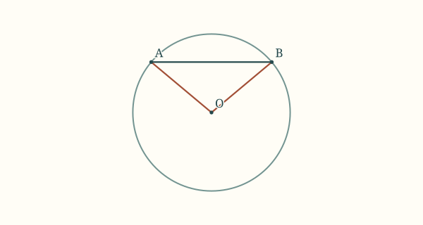

# 圆的方程确定了哪些点？弦与弧有什么区别？

在平面上给定点 $O$ 和正数 $r$，考虑所有满足 $OP=r$ 的点 $P$。任一方向上，从 $O$ 出发延伸长度 $r$ 就得到一个这样的点。反过来，任一符合条件的点都能由其方向和长度这样取得。因此让定长线段绕一端转动一周，恰好描出以 $O$ 为圆心、$r$ 为半径的**圆**。若把条件改为 $OP\le r$，还会包含内部的点，得到的是圆盘。

取圆上两点 $A,B$。连接它们的线段 $AB$ 称为**弦**，两点同时把圆周分为两段**弧**。仅给端点无法区分想说哪一段弧，可以再指明弧所经过的第三点。经过圆心的弦称为**直径**，其两半分别是方向相反的半径，长为 $2r$。

怎样度量选定的一段弧？让半径从 $OA$ 沿这段弧转至 $OB$，转过的角度称为**弧的度数**。若较小圆心角为 $100^\circ$，则两弧的度数分别为 $100^\circ$ 和 $260^\circ$。把整个圆放大两倍，同一转角截出的弧长加倍，度数却保持不变。要由角度求弧长还须知道半径。

在圆上另取一点 $P$，连接 $PA,PB$，便得到与同一条弦相关的另一种角。此时弦的两段弧中，哪一段决定了角 $APB$？这正是[圆周角定理](inscribed-angle.md)需要明确的问题。
