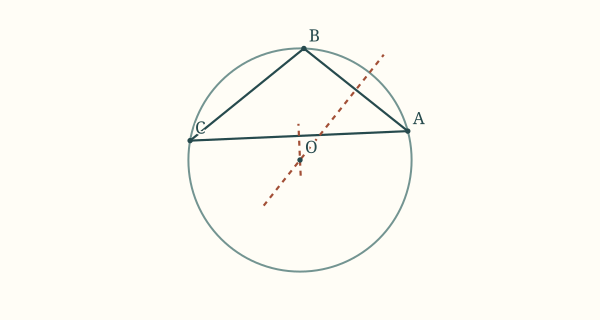

# 三个点为何可以唯一确定外接圆？

经过不同两点 $A,B$ 的圆有许多。再要求经过 $C$ 时，要分别检查两件事，符合要求的圆是否存在，以及存在时是否唯一。

假定圆已作出，设圆心为 $O$。由半径相等知 $OA=OB$，因此 $O$ 必在 $AB$ 的[垂直平分线](bisector.md)上。同理，$OA=OC$ 又要求它位于 $AC$ 的中垂线上。这样，原来需要同时确定的圆心与半径，转化成先求两条直线的公共点。

若 $A,B,C$ 不共线，直线 $AB,AC$ 方向不同，各转一个直角后方向仍不同，因而两条中垂线相交于唯一一点 $O$。刚才只是猜测圆心该在哪里，现在可以回头检查：交点到 $A,B$ 等距，也到 $A,C$ 等距，因此 $OA=OB=OC$。以它为圆心、取 $OA$ 为半径，的确能画出所求圆。任何满足要求的圆心都只能是这个交点，半径也随之确定。这就是三角形的**外接圆**，其圆心叫**外心**。第三条边的中垂线会自己经过 $O$。

图中的钝角三角形，其外心落在三角形外。若预先只在三角形内寻找，就会漏掉它。若三个不同点共线，$AB,AC$ 的中垂线平行且不同，此时没有任何圆心能同时满足要求。

经过三个不共线点的圆心和半径都已确定。加入第四点后，问题因此变成新点是否还在同一圆上，可以利用[四点共圆](../concyclic.md)的角度判据检验。
