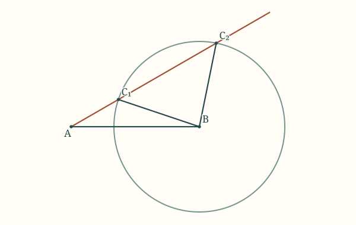

# 哪些数据足以唯一确定三角形的形状与大小？

给两个三角形规定三组相等的角，仍可以把其中一个成比例放大而保留全部角度。若希望它们能够完全重合，还须有长度数据固定尺度。除了长度和角的个数，哪些边与哪些角相邻也会影响结论。

先固定长 $6$ 的底边 $AB$，再给定 $AC=4$ 和 $\angle BAC=50^\circ$。在底边的一侧，角度确定从 $A$ 出发的射线，长度再唯一确定射线上的点 $C$。底边另一侧的解与它镜面对称，可以重合。由此得到**边角边**判定，所给的角是两条已知边的夹角。

同样地，若给 $AB$ 以及 $A,B$ 两处的内角，$C$ 必须同时落在两条按角度作出的射线上。只要是一个真正三角形的尺寸，射线便有唯一交点。这是**角边角**。知道两角和另一条对应边也可以，先由[内角和](triangle-angles.md)算出第三角，把已知边两端的角补齐即可。

若给三边长，固定 $AB$ 后，点 $C$ 须同时在以 $A,B$ 为圆心、对应边长为半径的两圆上。每个半平面内至多有一个交点，若有两个交点，它们关于 $AB$ 对称。因此已经存在的两个三角形若三边对应相等，就能完全重合，即**边边边**。存在性还要求两短边之和大于最长边，等号对应三点共线。

把“夹角”换成其中一条边的对角，会怎样？令 $AB=6$，在 $A$ 画与 $AB$ 成 $30^\circ$ 的射线，要求 $BC=4$。从 $B$ 到这条射线的垂距是 $3$（$30^\circ$ 直角三角形的短边为斜边的一半）。圆心 $B$ 到射线的距离小于半径 $4$，而射线起点 $A$ 又在圆外。垂足落在射线前方，因此射线先进入圆再穿出去，有两个顶点 $C_1,C_2$ 可选。所得两条 $AC$ 的长度不同，确有两个不全等的解。同样是三个数据，把夹角换成对角，唯一性就可能消失。

直角三角形有个例外很实用。给定一条直角边和斜边，另一条直角边沿已知边端点的垂线伸出，离对端的距离从这条已知直角边长起严格增加，达到指定斜边长时位置就确定了；也可由[勾股定理](pythagoras.md)求出另一条边再用边边边。比较两幅图时记得先确定哪个顶点对应哪个顶点，配错边时，上述构造对应的可能是不同的三角形。
