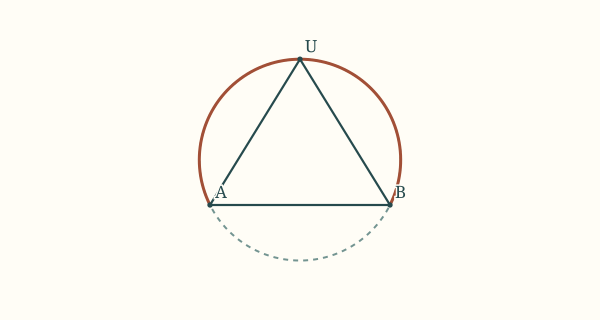

# 在线段的指定一侧，哪些点对它张相同的角？

在线段 $AB$ 的指定一侧，求所有满足 $\angle APB=\alpha$ 的点，其中 $0^\circ<\alpha<180^\circ$。当 $\alpha=90^\circ$ 时，轨迹是一个半圆去掉两个端点。若改为 $55^\circ$ 或 $130^\circ$，如何确定对应弧，并证明没有漏点？

先增加对称条件 $UA=UB$ 来构造一个解。等腰三角形的两底角必须同为 $(180^\circ-\alpha)/2$。从 $A,B$ 向指定半平面各作一个这样的底角，两射线唯一相交于 $U$。现在有了确定的三个不共线点，可借它们确定一个候选圆。

经过 $A,U,B$ 画出[唯一的外接圆](circumcircle.md)。它在指定一侧的开弧经过 $U$。在这段弧上任取 $P$，$\angle APB$ 和 $\angle AUB$ 截的是同一条对侧弧，[圆周角定理](inscribed-angle.md)保证二者相等。注意，即使 $\alpha$ 很大，取的仍是 $U$ 所在一侧的那段弧，不能机械地选长弧或短弧。

还须证明满足条件的点一定属于该弧。设 $P$ 也在指定侧并量得 $\alpha$，先给它单独画出圆 $ABP$。在这个新圆上，取 $P$ 所在那段 $AB$ 弧的中点 $V$。这个点到 $A,B$ 等距，因为将图沿弦的中垂线翻折会交换 $A,B$ 并保持该段弧。$V$ 和 $P$ 还看着同一段对侧弧，所以 $\angle AVB=\alpha$。因此 $V$ 必是我们最先确定的、唯一满足 $UA=UB$ 的解 $U$。两个圆现在都经过 $A,U,B$，它们原来就是同一个圆。

两个方向的证明共同确定了完整轨迹。端点 $A,B$ 不计入，那里没有可量的角。若把两侧位置都允许进来，还应该添上这段开弧关于 $AB$ 的镜像；两段弧一般属于不同的圆，只有 $\alpha=90^\circ$ 时会拼成同一个直径圆（仍少两个端点）。[四点共圆的逆向判断](../concyclic.md)正要用到这里的“没漏”。
