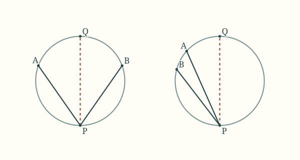

# 圆周角为什么等于它所对弧的度数的一半？

固定同一圆上的两点 $A,B$，让另一点 $P$ 沿开弧 $AB$ 移动。线段 $PA,PB$ 的长度随位置而变，夹角 $\angle APB$ 是否也变？若能把它与一段固定弧的度数联系起来，就能在移动过程中判断角度。

两端点 $A,B$ 将圆分为两段弧。我们要比较 $\angle APB$ 和**不含顶点 $P$ 的那一段弧**。先考虑一边 $PA$ 是直径的情形，设圆心为 $O$，连接 $OB$。由于 $OP=OB$，$\triangle OPB$ 两底角皆为 $x=\angle APB$。$\angle AOB$ 是这个三角形的[外角](triangle-angles.md)，故等于 $2x$，又恰好等于所取弧的度数。这样已证明一个可以推广的特殊情形。

点 $P$ 取一般位置时，可以补作一条从 $P$ 通到圆对面的直径 $PQ$。刚才的一半关系可分别用在 $\angle APQ$ 和 $\angle QPB$ 上。若射线 $PQ$ 位于角的两边之间，弧 $AQ$ 和 $QB$ 正好首尾相接，拼成不含 $P$ 的弧 $AB$；两个圆周角也正好相加，倍数关系仍然成立。若 $PA,PB$ 落在直径的同一边，两条从 $Q$ 量起且不经过 $P$ 的弧一长一短。小弧被大弧包含，差就是需要的弧，$P$ 处夹角也由大角减小角得到。若一边恰与直径重合，就已经回到第一种特殊情形。

因此，只要 $A,B,P$ 是圆上三个不同点，$\angle APB$ 就等于不含 $P$ 的弧 $AB$ 度数的一半。如果这段弧有 $246^\circ$，圆周角为 $123^\circ$。若只看通常标作小角的 $\angle AOB=114^\circ$ 再除二，就会误算成 $57^\circ$。那是顶点位于弦另一侧时所得的角。

**点 $P$ 在同一段开弧上移动时，所截的对侧弧固定，所以圆周角固定。** 换到弦的另一侧，两角所对的弧合计一周，两圆周角就互补。若反过来只给定角度，其顶点是否一定落在这段圆弧上？参见[定角所见弦的轨迹](fixed-angle.md)。
