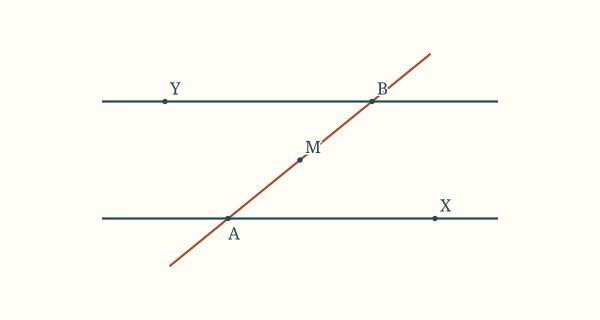

# 如何由一处量得的角推断另一处的方向？

直线 $l$ 外有一点 $B$。要过 $B$ 作 $l$ 的平行线，单看有限长度的两段没有相交，不足以判断整条直线的关系。能否只借一条截线确定方向，同时给出两线永不相交的理由？

先让一条横穿的直线分别经过 $l$ 上的 $A$ 和点 $B$。在 $A$ 处，取 $l$ 上朝右的射线 $AX$，量它与射线 $AB$ 的夹角。来到 $B$ 处，沿 $BA$ 往回看，在截线的另一侧画 $BY$，使 $\angle ABY=\angle XAB$。这两个角都夹在两条待比较的线之间，又分居截线两旁，叫作**内错角**。

为什么这能画出平行线？取 $AB$ 的中点 $M$，把整张图绕 $M$ 转半周，$A$ 恰好落到 $B$，$AB$ 变成 $BA$，$AX$ 的新方向恰好是 $BY$。原直线和转出来的直线倘若交于 $P$，那么 $P$ 转到的新点也在两线上。一对相交的不同直线只能有一个交点，所以 $P$ 只能是转后留在原地的 $M$。可是 $M$ 不在 $l$ 上。两线于是平行。这里横穿的直线须真的穿过 $l$，$B$ 也须在 $l$ 外。

反过来，若已知一条过 $B$ 的直线与 $l$ 平行，如何推出同样的角度关系？在欧氏平面里，我们采用这样一条基本约定：过直线外一点有且只有一条直线与原直线平行。它只能是刚才转出来的那一条，两个标出的内错角因而相等。这里正是平行线的唯一性保证了逆向结论。

再试着只记一个角。假设它是 $62^\circ$，它的对顶角也是 $62^\circ$，因为它们都与同一个邻角拼成 $180^\circ$。剩下两个邻角各为 $118^\circ$。在另一个交点，用刚才的内错角关系就能把四个角全部找回来。若选择在两个交点占据相同位置的两角，称为**同位角**。将其中一个角换成它的对顶角，就化成刚才的一对内错角，故平行时同位角也相等。同旁内角则选截线同侧、两直线之间的两角，其中一个与刚才的等角构成邻补角，故它们相加为 $180^\circ$。这样的搬运会在[三角形内角和](triangle-angles.md)里省下一次原本做不到的测量。
