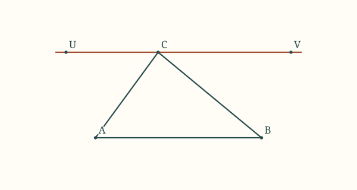

# 怎样由平行线推出三角形内角和？

一个欧氏平面三角形的边长和角度都可变化，但无论顶点如何移动，三个内角的和似乎总是一样。精确测量有限幅图只能提出猜想。要证明这个和等于一个平角，可尝试把三个角同时表示在一条直线的同一侧。

设三角形为 $ABC$，先选 $C$ 为共同顶点。角 $A$ 的一边在直线 $AC$ 上，若经过 $C$ 补一条平行于 $AB$ 的线，就能在 $C$ 处得到与角 $A$ 相等的角。对角 $B$ 也恰好需要同一条平行线。因此过 $C$ 作 $AB$ 的平行线，在线上依次取 $U,C,V$，令 $CU$ 与 $BA$ 同向。

以 $AC$ 作截线，由[内错角相等](parallel-angles.md)，$\angle UCA=\angle CAB$。同样以 $BC$ 作截线，$\angle BCV=\angle ABC$。沿三角形所在一侧从 $CU$ 转到 $CV$，恰好依次经过射线 $CA,CB$，这三个角不重叠也不留缝。于是
$$
\angle CAB+\angle ACB+\angle ABC=180^\circ .
$$

例如已知两角为 $47^\circ$ 和 $68^\circ$，第三角只能是 $65^\circ$。这里也有一个检验办法：如果量得的三个内角中有两个都是直角或钝角，就无法给第三角留下正的角度。

把 $AB$ 穿过 $B$ 向外延长到 $D$，新出现的 $\angle CBD$ 是顶点 $B$ 的一个外角。它和内角 $\angle ABC$ 拼满 $180^\circ$。刚才搬过来的另外两个内角之和也占同样多，所以 $\angle CBD=\angle BAC+\angle ACB$。以后我们碰到由两条半径围成的等腰三角形时，一个外角就能把那两只相等的底角同时数进去。
